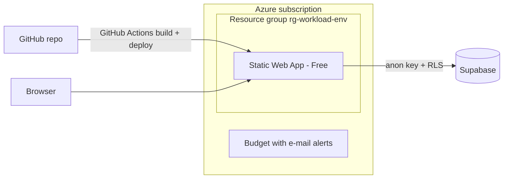

# Azure Static Web App as IAC

Infrastructure as Code for a React single-page app on **Azure Static Web Apps**, with a built-in **cost guardrail**.

> Status: infrastructure code written and validated in CI . It has **not** been deployed from this repo yet; the live app was created manually before.

## Architecture



## Cost guardrails

Avoiding unplanned cost is a design requirement, not an afterthought.

| Guardrail | Where | Effect |
|---|---|---|
| `@allowed(['Free'])` on the SKU parameter | `infra/modules/staticwebapp.bicep` | A deployment with a paid SKU fails at validation time |
| `@allowed` on the region | `infra/main.bicep` | Only regions supported by the Free plan |
| Monthly budget with alerts at 50 %, 90 %, 100 % of actual spend | `infra/modules/budget.bicep` | E-mail warning |
| Contact e-mail read from an environment variable | `infra/main.bicepparam` | No personal data in the repo |

## Naming and tags

CAF-style names such as `rg-fantasy-e-draft-dev` and `stapp-fantasy-e-draft-dev`, plus the tags `project`, `environment`, `owner` and `managedBy`.

## Repository layout

```
.
├── infra/
│   ├── main.bicep              # subscription scope: resource group, modules, outputs
│   ├── main.bicepparam         # parameter values (no secrets)
│   └── modules/
│       ├── staticwebapp.bicep  # Static Web App, Free only
│       └── budget.bicep        # monthly budget with alerts
├── docs/
│   ├── naming-convention.md
│   └── security-case-study-rls.md
└── .github/workflows/
    └── validate.yml            # bicep build + lint, Checkov scan
```

## Deploy

```bash

# 1. Validate without creating anything
az deployment sub validate \
  --location westeurope \
  --parameters infra/main.bicepparam

# 2. Preview the changes
az deployment sub what-if \
  --location westeurope \
  --parameters infra/main.bicepparam

# 3. Deploy
az deployment sub create \
  --location westeurope \
  --parameters infra/main.bicepparam
```

The parameter file uses `env = 'dev'` so a first run does not collide with resources that were created manually under `prod` names.

## Status

- [x] Bicep code for resource group, Static Web App and budget
- [x] CI workflow for build, lint and Checkov
- [ ] CI run green on GitHub
- [ ] First deployment from this repo to a `dev` environment
- [ ] `what-if` in CI via OIDC federation (no stored secrets)
- [ ] Log Analytics / Application Insights module

## Security notes

- No secrets in the repository. `.gitignore` excludes env files and keys.
- The deployment token of a Static Web App and all application keys live in GitHub repository secrets only.
- Front-end build variables (`VITE_*`) end up in the browser bundle. Only public values such as the Supabase anon key belong there; access control is enforced by Row Level Security. See [docs/security-case-study-rls.md](docs/security-case-study-rls.md).
- Checkov currently runs with `soft_fail: true`. Findings are to be reviewed and then enforced.

